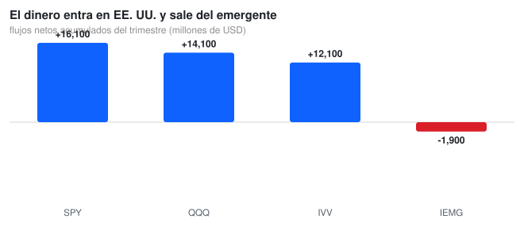
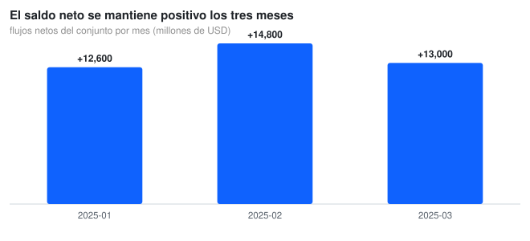

# 📈 ETFbook Data Analytics Case Study

**Financial Data Analysis | BigQuery SQL | Python | Streamlit Visualization**

[](https://www.python.org/)
[](https://cloud.google.com/bigquery)
[](https://streamlit.io/)
[](https://opensource.org/licenses/MIT)

---

## 📊 Interactive report

**[Open the interactive report →](https://nicolenki7.github.io/ETFbook-data-analytics-case-study/report.html)** — net flows by ETF and by month, rebuilt from `data/etf_flows_trend_analysis_2025.csv`.

---

## 📋 Overview

ETF flow analysis with SQL, Python and an interactive Streamlit front end. The three layers are deliberately separate: **SQL** answers the analytical questions, **Python** validates the numbers, and **Streamlit** exposes them without requiring SQL knowledge.

---

## 🎯 The business question

**When money moves between US and emerging-market equity ETFs, where does it actually go, and does the direction hold month after month?**

Flows matter more than returns for an issuer or a distributor: a fund can be up 20 % and still be bleeding assets. The question is therefore not *how the ETFs performed* but **who is receiving the money and who is losing it**, and whether that pattern is a one-month blip or a trend.



---

## 📊 What the data says

### The money enters the US and leaves emerging markets

Over the quarter, **SPY +16,100 M**, **QQQ +14,100 M**, **IVV +12,100 M** and **IEMG −1,900 M** (millions of USD). The three US vehicles take in **+42,300 M** while the emerging-market one loses **−1,900 M**: the same investor base is rotating towards US equity, and the outflow from EM is small next to the inflows but has the opposite sign every single month.

### The net balance stays positive for all three months



**+12,600 M** in January, **+14,800 M** in February, **+13,000 M** in March: the aggregate never turns negative. That is worth stating carefully — one of the four funds is negative every month, so the positive total is the sum of a concentrated inflow, not a broad one.

> **Honest scope:** the versioned CSV is a **12-row sample** (4 ETFs × 3 months), not a full market extract. The figures above describe exactly that sample, and `src/etfbook_charts.py` regenerates them from the file so they can never drift. They are not a claim about the real ETF market.

---

## 📁 Project structure

```
etf_flows_analysis/
├── data/etf_flows_trend_analysis_2025.csv   flows by ETF and month (the source of the charts)
├── sql/
│   ├── etf_flows_analysis.sql               aggregation by ETF and month
│   ├── flows_day_over_day.sql               window function: daily change
│   ├── flows_ranking.sql                    ranking by net flow
│   └── top_3_etfs_daily.sql                 top 3 per day
├── notebook/analysis.py                     Python validation of the SQL results
└── streamlit/app.py                         interactive dashboard
src/
├── etfbook_charts.py                        the two charts in this README (SVG)
├── build_report.py                          builds docs/report.html from the CSV
├── report.py                                shared report generator (CSS + JS + helpers)
└── svg_chart.py                             dependency-free SVG bar chart generator
docs/img/*.svg                               charts used here
docs/report.html                             one-page visual report (published with GitHub Pages)
```

---

## ▶️ Reproduce it

```bash
git clone https://github.com/Nicolenki7/ETFbook-data-analytics-case-study.git
cd ETFbook-data-analytics-case-study

python -m venv .venv && source .venv/bin/activate
pip install -r requirements.txt

python src/etfbook_charts.py                 # regenerates docs/img/*.svg from the CSV
python src/build_report.py                   # rebuilds docs/report.html
examples/notebook/analysis.py                # Python validation of the SQL results
streamlit run etf_flows_analysis/streamlit/app.py
```

The dashboard lives in `etf_flows_analysis/streamlit/app.py`, not at the repository root. The SQL files run against BigQuery: set `GOOGLE_APPLICATION_CREDENTIALS` to a service-account key with read access to the dataset before using them.

---

## 🛠️ Technical stack

| Category | Technologies |
| :--- | :--- |
| **Data Warehouse** | Google BigQuery |
| **Data Processing** | Python, Pandas |
| **Visualization** | Streamlit, Plotly |
| **Query Language** | SQL (BigQuery dialect) |
| **Deployment** | Streamlit Cloud |

---

## 📏 Metrics

| Metric | Value |
| :--- | :--- |
| Rows in the versioned CSV | **12** (4 ETFs × 3 months) |
| Net flows, quarter | **+40,400 M USD** |
| US vs EM | **+42,300 M** / **−1,900 M** |
| Monthly aggregate | **+12,600 / +14,800 / +13,000 M** |
| Funds with a negative month | **1 of 4 (IEMG, every month)** |

---

## 🚧 Limitations

- **The CSV is a sample**, not a market extract: four tickers and one quarter cannot support a sector conclusion.
- **Flows are already netted** by the source; the repo cannot show gross creations vs redemptions, so a rotation driven by redemptions looks identical to one driven by creations.
- **No prices, NAV or returns** in the dataset, so flow and performance cannot be related here.
- **`region` has two values only** (US / EM); Europe, Asia-Pacific and fixed income are not represented.
- The BigQuery SQL files require external credentials and a populated dataset; they are not executed by the scripts above.

---

## 📝 Resumen en Español

Análisis de flujos de ETFs en tres capas: **SQL** para las preguntas analíticas, **Python** para validar los números y **Streamlit** para exponerlos. Sobre la muestra versionada (4 ETFs × 3 meses), el dinero entra en los vehículos de EE. UU. (**+42.300 M USD** entre SPY, QQQ e IVV) y sale del emergente (**IEMG −1.900 M**, negativo los tres meses). El saldo total se mantiene positivo (**+12.600 / +14.800 / +13.000 M**), pero es la suma de una entrada concentrada, no de un movimiento general. El CSV es una muestra de 12 filas y las cifras describen exactamente esa muestra, no el mercado.

---

## 🔗 Links

| Resource | URL |
| :--- | :--- |
| **Repository** | https://github.com/Nicolenki7/ETFbook-data-analytics-case-study |
| **Interactive report** | https://nicolenki7.github.io/ETFbook-data-analytics-case-study/report.html |

---

## 📄 License

MIT License

---

## 👤 Author

**Nicolás Zalazar** | Data Analyst · Aspiring Data Engineer · Mallorca, Spain

- GitHub: [@Nicolenki7](https://github.com/Nicolenki7)
- LinkedIn: [nicolas-zalazar-63340923a](https://www.linkedin.com/in/nicolas-zalazar-63340923a)
